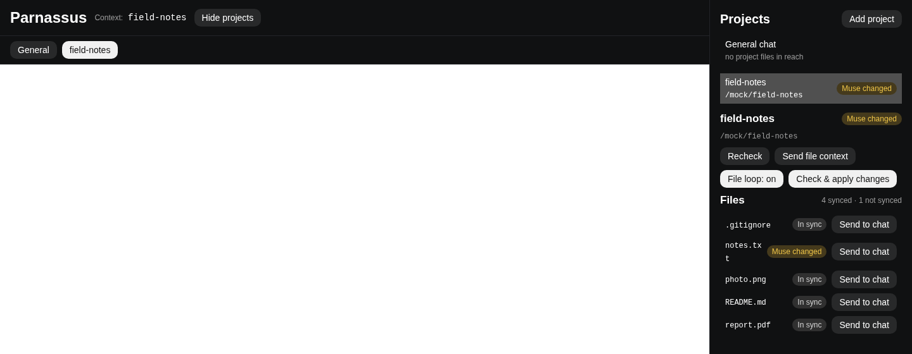
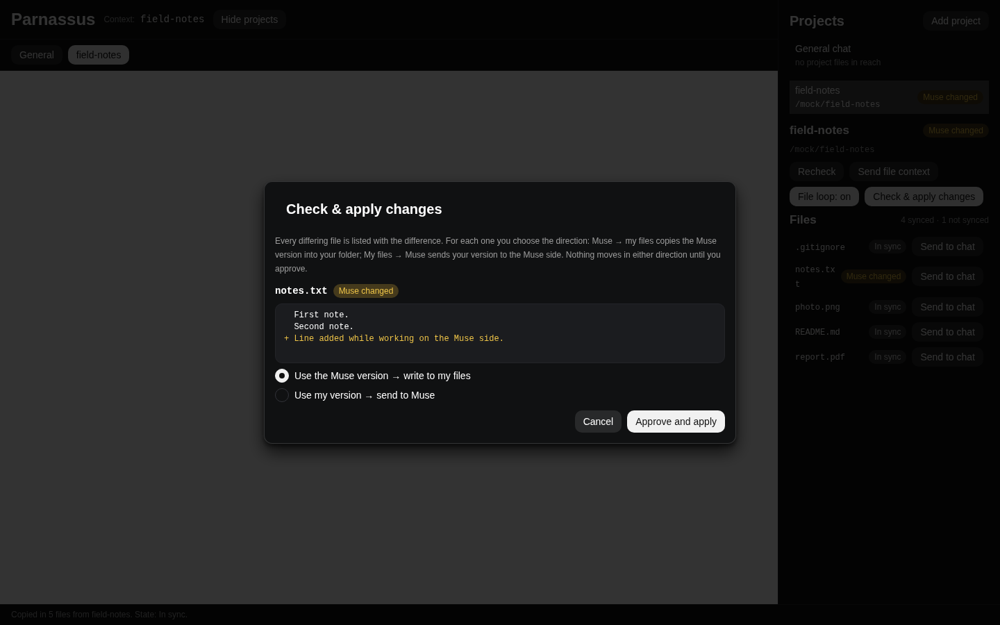

# Parnassus

A desktop client for Muse. Parnassus holds no user data of its own: your
files stay in your folders, work happens on copies, and nothing is written
back without your approval.

**Status: v0.1.1, a public v1 of the inbound half.** Context flows in
(project description, file summaries, full files on request through the
file loop), and changes are reviewed before anything is written back —
but the return path is still simulated: Muse-side edits arrive as a
marker line, not real agent changes yet. One Electron codebase builds
for Linux, macOS, and Windows in CI; every build is unsigned, with no
auto-update — a new release on GitHub is the update channel.





Screenshots are from the browser preview with the seeded mock project;
in the desktop app the left pane embeds muse.ai itself. Licensed under
the [MIT License](LICENSE).

## The three ideas

**Owns nothing.** The app stores no document content for itself. The staging
area holds working copies you asked it to make; your originals are yours.
Account data stays with Meta, the party you already trust or do not, and the
app adds no second copy of your life anywhere.

**The Airlock.** Files move in exactly two ways, both explicit:

- Copy in: you pick a folder. Parnassus scans it shallowly (top level only,
  subfolders are listed, not copied), classifies each file by content
  (text, readable binary such as images and PDFs, opaque binary such as
  executables), skips junk (`.git`, `node_modules`, build outputs, caches,
  `.gitignore` matches, files over 5 MB), and shows you every skip with its
  reason. Every file gets a tick box: copyable files start ticked, skips
  and subfolders start unticked, and only ticked files are copied — adding
  the folder by itself copies nothing. The copy goes to a staging area; a
  manifest records each file's hash, size, and modification time.
Each project also states a goal and an agent soul, inherited from the
generic pair until the project updates its own. A project's own values —
and its recorded decisions and internal knowledge (which files need what
done in them, conventions, facts about the project) — live as plain
markdown in the project folder itself: `.parnassus/goal.md`, `soul.md`,
`decisions.md`, and `memory.md`. The knowledge files are created with
starter headings when a project is copied in, are never overwritten,
never appear in scans, and are re-read from disk whenever a project is
opened or rechecked, so editing them in a text editor just works. They
are edited as files, not in the app: the side pane shows only the
project list and, for the selected project, a file tree with each
file's sync state and a synced / not-synced summary.

Each project has its own chat, isolated from the General chat and from
every other project: its own Electron session partition, and its own
muse.ai conversation. A project chat opens Muse's new-thread route
(`/thread/new`) on first open — never the main chat at `/`, where the
previously selected conversation would show — and once that thread
becomes a real conversation its URL is saved with the project and
reopened with it. The main-chat and new-thread draft URLs are never
saved as a project's chat. The thread is named after the project in
Muse's chat list. Switching chat
(the tabs over the chat pane, or the project list)
also selects that project, so context, files, goal, and knowledge always
belong to the chat on screen.

A project's chat does not see files on its own. Context goes in two
tiers. First a description pack: it states that the chat is only for
this project and must carry the project's name, points the agent at the
folders holding this project's files — your project folder and its
`.parnassus` knowledge folder, the staging folder with the working
copies, and a per-project folder on the Muse side
(`~/parnassus/projects/<project>-<id>/`) that the agent must keep this
project's work in — plus the goal, soul, project memory, and a summary
of each copied-in file (an opening excerpt for text, kind and size for
binaries), not the files themselves. Retrieval then runs as a loop:
the pack tells the agent not to guess content from summaries, and to
ask for a file it needs with one marker line,
`PARNASSUS_FILE_REQUEST: <path>`. Parnassus watches the open project
chat for that marker, sends that one copied-in file's full content as
the next message, and the agent answers with the file in hand — or
requests another file the same way. The loop is on by default and can
be turned off ("File loop" in the project pane); a file can also be
sent manually from the file tree's "Send to chat" action. There is no
direct upload channel to Muse's storage from here: the pack is a
message in the chat, which is also why it is re-sent when it changes.

Changes between your files and the Muse side are applied from one
review: "Check & apply changes" lists every differing file with its
diff, and for each you choose Muse → my files or My files → Muse.
One-sided changes come preselected with their only sensible direction;
a conflict has no default. Nothing moves in either direction until you
approve, and a Muse-side deletion is never applied to your folder.

- Save back: edits happen on the staged copies. When you open a project,
  Parnassus runs a three-way check (manifest as the base, your folder as one
  side, the staged copies as the other) and reports one of four states per
  file: in sync, local changed, Muse changed, conflict. Muse-side changes
  are written back only from the review dialog, one approval for the whole
  trip. A file that changed on both sides is never overwritten: you pick the
  winner from a diff first.

**Workspaces are the boundary.** Each project is a workspace: its copied
files, its state, its conversations. The chat pane always shows its context
in the header, General or a project name, so a message never lands in the
wrong project's reach by mistake. The project list doubles as a status
board: every row carries its sync state.

## Layout of the app

Chat on the left (an embedded view of muse.ai), projects on the right. The
window hides to the tray; `Ctrl+Shift+M` shows or hides it.

## Stack

Electron, TypeScript throughout, Bun as package manager and script runner.
The renderer is React 19 with Astryx components (@astryxdesign/core) and a
custom dark theme built by extending the neutral theme (near-black
surfaces, dense layout, monospace for paths and state labels, color reserved
for sync-state meaning). The main process owns all filesystem access behind
a bridge interface; the renderer never touches the filesystem directly.

## Develop

```bash
bun install
bun run dev        # Electron app with the real filesystem bridge
bun run dev:web    # Renderer alone in a browser, on the mock bridge
```

In browser mode there is no Electron preload, so the renderer falls back to
an in-memory mock implementation of the same bridge interface, seeded with
a small fake project tree. Nothing in browser mode touches the real disk.

## Test

```bash
bun run test       # Unit tests (bun test): classification, the three-way
                   # state computation, and the real bridge over a temp dir
bun run test:e2e   # Playwright, Chromium, against the vite dev server.
                   # Every file call is served by the mock bridge; the
                   # integration tests never touch the real filesystem.
bun run typecheck
```

## Build and package

```bash
bun run build      # electron-vite production build into out/
bun run package    # plus electron-builder Linux packages into dist/
```

CI (.github/workflows/build.yml) runs the unit tests and typecheck, builds
the app, and produces an AppImage and a tar.gz, uploaded as workflow
artifacts and attached to GitHub releases on version tags. There is no
store account, no signing, and no auto-update machinery: a new release is
the update channel.

The Flatpak manifest lives in flatpak/ (app id
io.github.dmytroportianka.Parnassus). It packages the tar.gz build: place
the release tarball next to the manifest as parnassus.tar.gz, then run
flatpak-builder. A separate CI job does this on release tags. The manifest
grants no broad filesystem access; folder picking goes through the file
portal, which is the Airlock model applied to packaging.

## Deliberate v1 limits

- Readable binaries (images, PDFs, audio) and subfolders are listed in the
  scan and can be included from the scan dialog, but their payloads are not
  yet copied lazily on demand; including one copies it with everything else.
- A Muse-side deletion never deletes your file. It is reported as blocked
  at save back.
- The gitignore matcher is a small subset: extension globs, plain names,
  directory patterns, and anchored patterns. Negations are not supported.
- The chat pane embeds muse.ai; there is no direct Muse API integration,
  and sign-in happens in the embedded view itself.
- Muse-side edits are simulated (a marker line appended to the staged
  copy) so the review and save-back flow can be exercised end to end.
